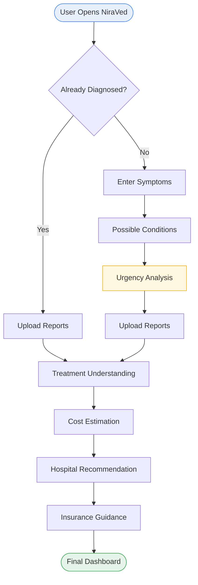
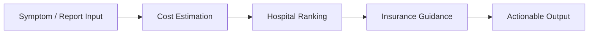
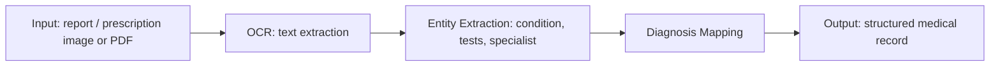
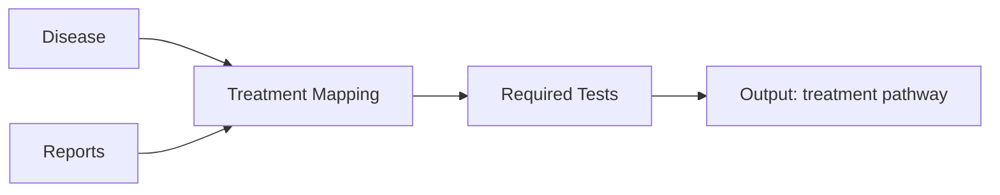
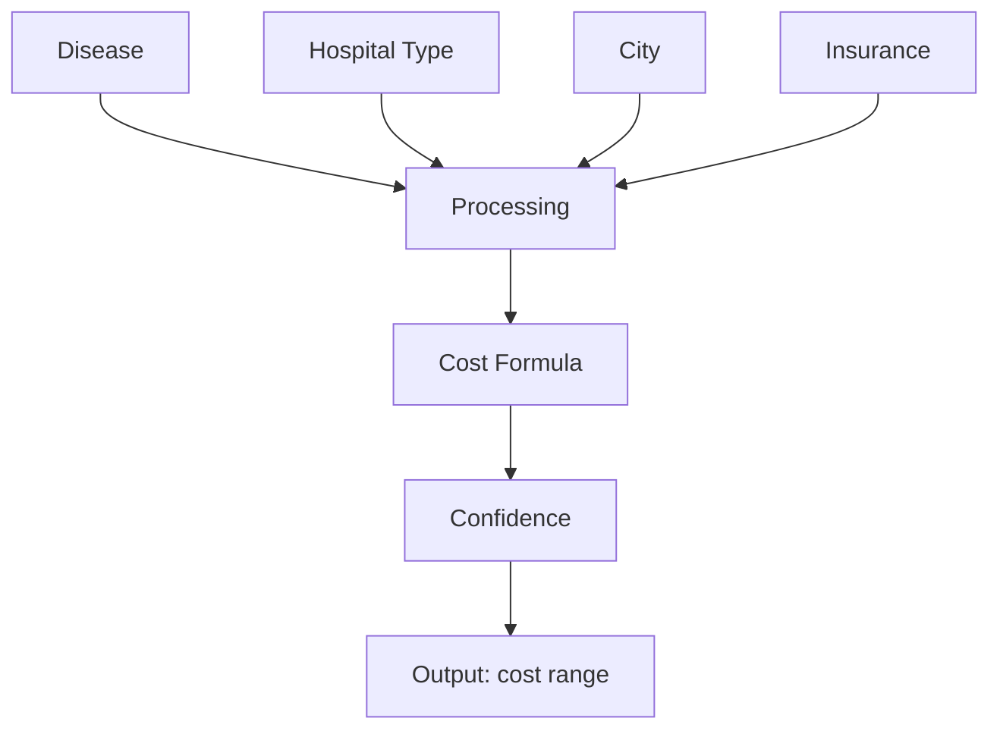
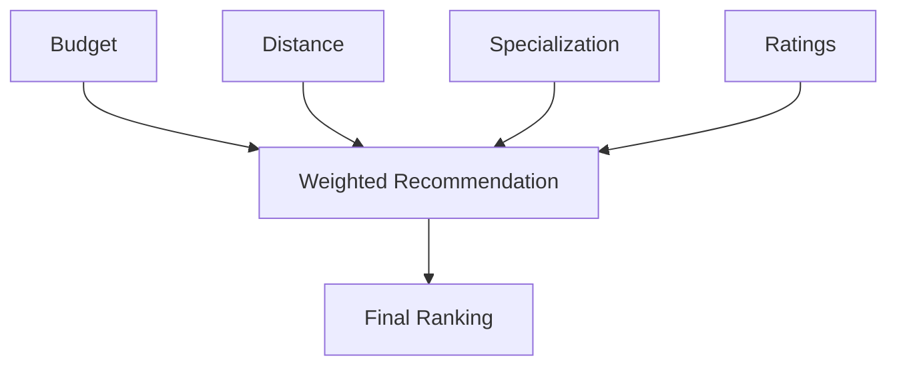
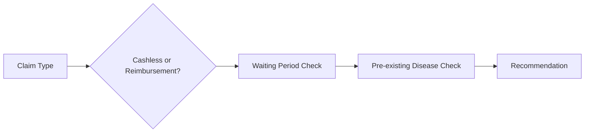
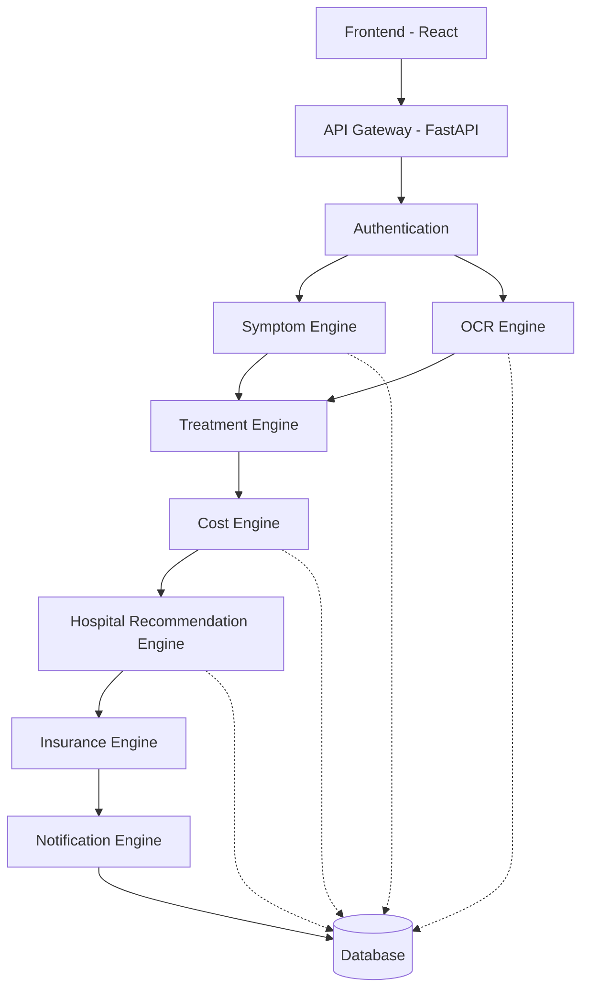
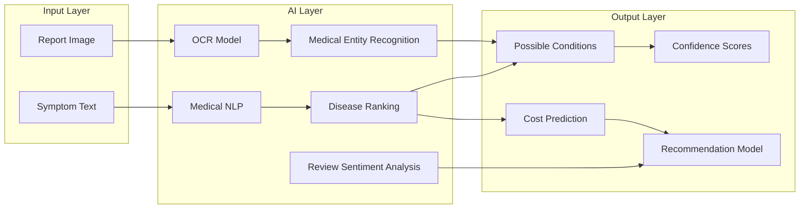
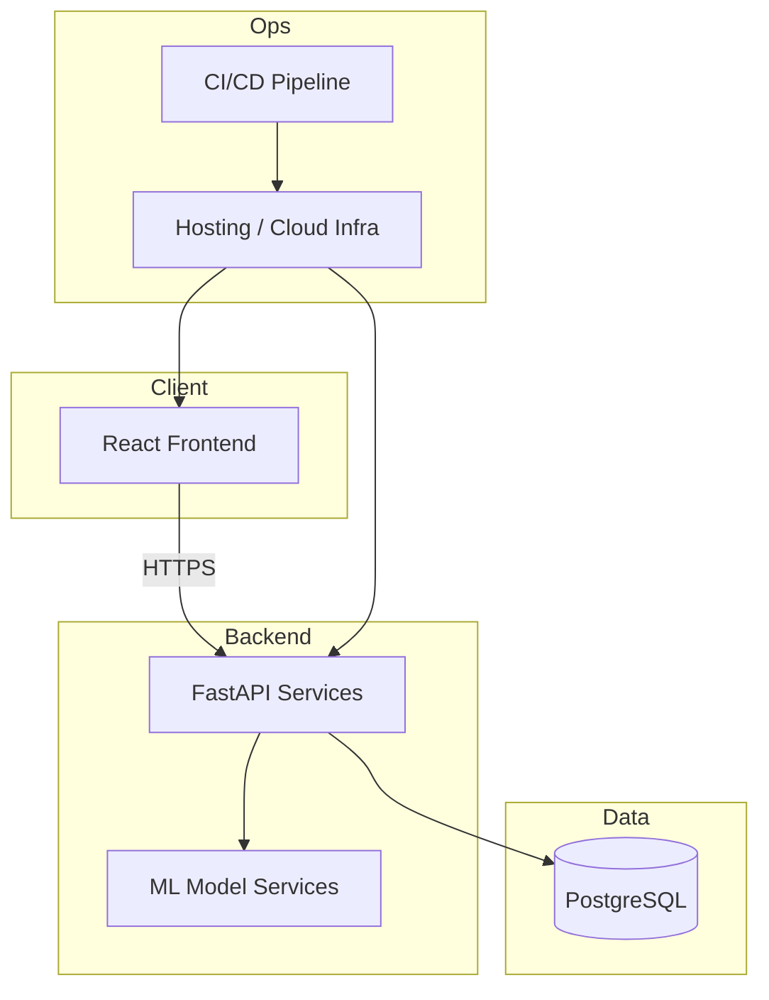

# NiraVed

**Know Your Care Before You Pay.**

> An AI-powered healthcare decision-support platform that guides a person from *"something feels wrong"* to *"here's what to do, what it costs, and how to pay for it"* — in one continuous, explainable flow.

<p align="left">
  
  
  
</p>

---

## Table of Contents

1. [Executive Summary](#1-executive-summary)
2. [Problem Statement](#2-problem-statement)
3. [Solution Overview](#3-solution-overview)
4. [Persona / Real-World Use Case](#4-persona--real-world-use-case)
5. [User Journey](#5-user-journey)
6. [System Workflow](#6-system-workflow)
7. [Complete Engineering Pipeline](#7-complete-engineering-pipeline)
8. [Feature Breakdown](#8-feature-breakdown)
9. [Backend Architecture](#9-backend-architecture)
10. [AI / ML Architecture](#10-ai--ml-architecture)
11. [Decision Engine](#11-decision-engine)
12. [Data Sources](#12-data-sources)
13. [Tech Stack](#13-tech-stack)
14. [Repository Structure](#14-repository-structure)
15. [Research Foundation](#15-research-foundation)
16. [APIs & Integrations](#16-apis--integrations)
17. [Confidence System](#17-confidence-system)
18. [Design Principle: Accuracy &lt; Usability](#18-design-principle-accuracy--usability)
19. [Design Decisions](#19-design-decisions)
20. [Platform Justification — Why Web First](#20-platform-justification--why-web-first)
21. [Challenges](#21-challenges)
22. [Deployment Architecture](#22-deployment-architecture)
23. [Security & Privacy](#23-security--privacy)
24. [Future Roadmap](#24-future-roadmap)
25. [Summary](#25-summary)

---

## 1. Executive Summary

> **NiraVed in one minute:** describe your symptoms or upload a report → understand what it might mean and how urgent it is → know roughly what it will cost → find the right hospital for your budget → understand how your insurance actually works. All in one flow, all explainable, none of it pretending to be a doctor.

**Problem**
Patients face four unanswered questions before every treatment decision — *is this serious? what will I need? what will it cost? will insurance cover it?* — and today, answering them requires cold calls, guesswork, and post-treatment bill shock.

**Who it's for**
Anyone without a trusted personal physician who needs a fast, judgment-free first read on symptoms or a report — especially cost-sensitive, Tier-2/Tier-3 city users navigating out-of-pocket-heavy healthcare systems.

**Why it's different**
NiraVed is the only tool that chains *symptom → treatment path → cost range → hospital ranking → insurance guidance* into a single explainable pipeline, instead of solving one slice (a symptom checker, a hospital directory, an insurance FAQ) in isolation.

**What it is not**
Not a diagnostic tool. Not a booking engine. Not a replacement for a doctor. It is a **decision-support layer** that sits *before* those relationships begin.

**Current stage**
MVP — core pipelines are architected and specified below; several modules (marked `Planned` / `Future`) are roadmap items, not shipped features.

---

## 2. Problem Statement

Healthcare in most developing — and even developed — markets suffers from an **information asymmetry problem**, not just an access problem. A patient experiencing symptoms today typically faces four unanswered questions, in sequence:

1. *"Is this serious enough to see a doctor?"*
2. *"If I go, what tests and treatment will I actually need?"*
3. *"What will this cost me, realistically — not the number on a hospital brochure?"*
4. *"Will my insurance actually cover this, and how do I claim it?"*

Today, answering these requires calling multiple hospitals, asking around for referrals, reading dense insurance PDFs, and often discovering the real cost only *after* treatment has begun — at which point walking away is no longer an option.

> **This creates a compounding failure mode:**
>
> - Delayed care-seeking, driven by fear of an unknown bill
> - Panic-driven decisions at expensive private hospitals when a mid-tier option would suffice
> - Insurance claim rejections from unfamiliarity with waiting periods and exclusions
> - Financial shock, concentrated in out-of-pocket-heavy healthcare systems

There is no single tool today that connects *symptom → treatment path → realistic cost → hospital choice → insurance guidance* into one continuous decision-support flow. **NiraVed exists to close that gap.**

---

## 3. Solution Overview

NiraVed is a **decision-support layer over the healthcare system** — not a diagnostic tool, not a hospital booking engine. It sits between "I don't feel well" and "I've made an informed choice," and does three things exceptionally well:

Capability
What it means in practice

**Translates uncertainty into structure**
Symptoms or a messy prescription photo become a clear, structured picture of what's likely going on and what happens next

**Translates cost opacity into ranges**
Instead of one misleading number, a defensible cost band built from real scaling factors — location, hospital tier, treatment complexity

**Translates hospital & insurance complexity into explainable recommendations**
A ranked shortlist with a visible "why," not a list of ads

> ⚠️ **Boundary, stated plainly:** NiraVed does not diagnose. Every output is framed as decision support, carries clear disclaimers and urgency flags, and defaults to *"see a professional"* whenever signals suggest anything beyond mild severity.

---

## 4. Persona / Real-World Use Case

<details>
<summary><strong>Meet Ramesh, 34, small business owner, Tier-2 city</strong> — click to expand full walkthrough</summary>
<br>
Ramesh has had a persistent lower-back ache and mild fever for four days. He has no trusted family doctor, and a web search returns everything from "muscle strain" to "kidney infection." He's also cost-anxious — his last hospital visit ran 3x over expectation because no one mentioned tests would be billed separately.

**With NiraVed:**

1. Ramesh describes his symptoms in plain language.
2. NiraVed flags **"Consult a doctor within 24–48 hours"** urgency — not emergency, not "wait it out" — and lists 3 possible conditions, explicitly labeled as *possibilities, not a diagnosis*.
3. He visits a local clinic, gets a prescription and test recommendations, and photographs them.
4. NiraVed's document analyzer extracts diagnosis, tests, and doctor type, then estimates a **cost range** for the full workup — say, ₹3,200–₹5,800.
5. He sets preferences: mid-budget, private, within 5 km. NiraVed returns a ranked shortlist of 4 hospitals with a transparent score breakdown.
6. He has basic insurance. NiraVed walks him through coverage, waiting periods, and exactly what documents a cashless or reimbursement claim needs.

Ramesh never cold-calls a billing desk or reads a 40-page policy PDF. **That is the product.**

</details>

---

## 5. User Journey



Stage
What happens
Why it matters

**Already Diagnosed?**
A single branch point avoids forcing already-diagnosed users through an irrelevant symptom flow
Respects the user's time and existing context

**Enter Symptoms**
Structured free-text + guided fields (duration, severity, associated symptoms)
Structure improves NLP extraction quality without feeling like a form

**Possible Conditions**
Ranked, non-diagnostic candidate list
Sets correct expectations immediately — this is guidance, not a verdict

**Urgency Analysis**
Mild / Consult / Emergency classification
The single highest-leverage output — determines what the user does *next*, today

**Upload Reports**
OCR + entity extraction on prescriptions/labs
Converts unstructured paper into structured pipeline input

**Treatment Understanding**
Maps condition → standard test/consult/procedure pathway
Removes the "what do I even need" uncertainty before cost is discussed

**Cost Estimation**
Range, not point estimate
Sets a realistic financial expectation *before* commitment

**Hospital Recommendation**
Weighted ranking against user preferences
Turns an overwhelming hospital list into a short, explainable shortlist

**Insurance Guidance**
Claim walkthrough or plan guidance
Closes the loop on the #1 source of post-treatment financial surprise

**Final Dashboard**
Single consolidated view of all of the above
One screen a user can act on, or share with family

---

## 6. System Workflow

NiraVed operates as a **four-stage guided pipeline**. Each stage produces a structured output that feeds the next — the user is never dropped into a dead end.

### Stage 1 — Symptom / Diagnosis Input

Step
Behavior

1.1
Ask the user: *"Do you already have a diagnosis?"*

1.2a
**Yes** → skip directly to Stage 2 with the known condition pre-filled

1.2b
**No** → user enters free-text symptoms via a guided structured form

1.3
NLP symptom engine returns a ranked list of **possible conditions** — never a single definitive answer

1.4
System computes and displays an **urgency level**: `Mild` / `Consult a doctor` / `Seek emergency care`

> 🔖 Every output in this stage carries a persistent disclaimer: *"This is not a medical diagnosis. It is a guide to help you decide your next step."*

### Stage 2 — Reports, Treatment & Cost Estimation

Step
Behavior

2.1
User uploads reports, prescriptions, or lab results (image or PDF)

2.2
OCR + document analyzer extracts diagnosed condition, prescribed tests, specialist type

2.3
System maps the extracted condition to a **standard treatment pathway**

2.4
Cost engine computes a **range**, scaled by city tier, hospital category, treatment complexity

2.5
Low-confidence extractions are **explicitly flagged**, never silently guessed

### Stage 3 — Hospital Recommendation

Step
Behavior

3.1
User sets preferences: budget ceiling, distance radius, private vs. government, rating priority

3.2
Recommendation engine filters hospitals against hard constraints (budget, distance)

3.3
Remaining candidates scored via a **weighted multi-factor model**

3.4
Top-ranked hospitals returned with an explainable score breakdown

### Stage 4 — Insurance Guidance

Step
Behavior

4.1
Branch: does the user have existing insurance?

4.2a
**Yes** → step-by-step claim guidance (cashless vs. reimbursement, documents, network check)

4.2b
**No** → suggested plan categories with plain-language pre-existing-disease explanation

4.3
Waiting period rules explained explicitly — the #1 real-world cause of claim rejection



---

## 7. Complete Engineering Pipeline

NiraVed is decomposed into **six independent pipelines**. Each has its own input contract, processing steps, and confidence output — independence here is deliberate (see [§9 Backend Architecture](#9-backend-architecture)).

### Pipeline 1 — Symptom Analysis


### Pipeline 2 — Medical Report Analysis



### Pipeline 3 — Treatment Planning



### Pipeline 4 — Cost Estimation



### Pipeline 5 — Hospital Recommendation



### Pipeline 6 — Insurance Guidance



---

## 8. Feature Breakdown

Feature
Description
Status

Symptom-to-condition guidance
Safe, non-diagnostic possible-condition suggestions with urgency flagging
✅ Core

Report & prescription analysis
OCR-based extraction of diagnosis, tests, specialist type
✅ Core

Cost estimation engine
Rule-based + scaling-factor model producing defensible ranges
✅ Core

Hospital recommendation system
Multi-factor weighted ranking
✅ Core

Insurance advisory layer
Claim walkthroughs, plan suggestions, waiting-period explanations
✅ Core

Low-confidence flagging
Surfaces uncertain OCR/NLP extractions instead of silently guessing
✅ Core

Review sentiment analysis
Refines hospital quality scores beyond raw star ratings
🟡 Enhancement

Ambulance & doctor availability
Real-time availability layer
🔵 Planned

WhatsApp chatbot
Conversational access for low-bandwidth, low-literacy users
🔵 Planned

---

## 9. Backend Architecture



### Module Responsibilities

Module
Responsibility

**API Gateway**
Single entry point; request routing, rate limiting, response shaping

**Authentication**
User identity, session handling, consent tracking

**Symptom Engine**
NLP condition ranking + urgency classification

**OCR Engine**
Report/prescription text extraction

**Treatment Engine**
Condition → treatment pathway mapping

**Cost Engine**
Rule-based, scaled cost-range computation

**Hospital Recommendation Engine**
Weighted scoring and ranking against hospital dataset

**Insurance Engine**
Claim/plan rules and waiting-period logic

**Notification Engine**
Status updates, report-ready alerts (foundation for future chatbot/SMS)

**Database**
Persistent store for structured user, cost, and hospital data

> **Why independent services?** Cost tables and hospital datasets change far more frequently than the ML-facing symptom engine. Decoupling means a pricing update or a new hospital entry never requires redeploying — or re-validating — the AI layer. Each module can also be tested, scaled, and versioned on its own schedule.

---

## 10. AI / ML Architecture

For every model: **Purpose → Input → Processing → Output → Confidence → Limitations → Future Improvements.**



Model
Purpose
Input
Processing
Output
Confidence
Limitations
Future Improvements

**Symptom Understanding (Medical NLP)**
Map free text to candidate conditions
Free-text symptom description
Normalization → embedding/classification
Ranked candidate conditions
Per-condition probability score
Struggles with vague or multi-symptom input; not a substitute for clinical exam
Fine-tuned medical embeddings; multilingual support

**OCR**
Digitize prescriptions/reports
Image or PDF
Text-region detection → character recognition
Raw extracted text
OCR confidence per field
Handwriting and poor scan quality degrade accuracy
Upgrade path to Google Vision API for low-confidence cases

**Medical Entity Recognition**
Structure OCR output
Raw extracted text
NER over medical vocabulary
Condition, tests, specialist fields
Field-level confidence
Domain vocabulary coverage is finite
Expanded medical ontology, feedback-loop retraining

**Disease Ranking**
Prioritize candidate conditions
Symptom + report signals
Rule-weighted scoring over NLP output
Ranked list
Aggregate confidence
Rare/atypical presentations under-ranked
Ensemble with clinical guideline data

**Confidence Scoring**
Quantify trust in every output
All upstream model outputs
Weighted aggregation
Numeric/qualitative confidence label
— (this *is* the confidence layer)
Confidence ≠ correctness guarantee
Calibration against real-world outcome data

**Cost Prediction**
Estimate treatment cost
Disease, hospital type, city, insurance
Rule-based formula (see [§11](#11-decision-engine))
Cost range
Range-width as confidence proxy
Regional price data is sparse/approximate
Live pricing partnerships with hospitals

**Recommendation Model**
Rank hospitals
Budget, distance, specialization, ratings
Weighted multi-factor scoring
Ranked hospital list
Match-score percentage
Ranking quality bounded by data completeness
Learned weight personalization

**Review Sentiment Analysis**
Adjust ratings for hidden quality signals
Hospital review text
Sentiment classification
Adjusted quality score
Sentiment confidence
Review volume varies wildly by hospital
Aspect-based sentiment (billing, wait time, staff)

**Future LLM Integration**
Natural-language explanation & chat
User query + pipeline outputs
LLM-based summarization/reasoning over structured outputs
Conversational explanation
Inherits upstream confidence
Not yet implemented — conceptual
Grounded LLM layer (e.g. Gemini) constrained to pipeline outputs only, never freeform diagnosis

> 🧪 **Labeling discipline:** every row above describing something not yet built (e.g. Future LLM Integration) is explicitly marked **conceptual** — nothing here should be read as a shipped capability.

---

## 11. Decision Engine

This section explains **how** recommendations are actually generated — the arithmetic behind the ranking, not just the concept.

### Hospital Score Formula

```text
Hospital Score = (0.30 × Specialization Match)
			   + (0.25 × Cost Match)
			   + (0.20 × Rating)
			   + (0.15 × Distance Score)
			   + (0.10 × Review Sentiment)
```

Weight
Factor
Rationale

30%
Specialization Match
Getting the right department/specialist is the highest-impact factor for outcome relevance

25%
Cost Match
Directly reflects the platform's core promise — affordability fit

20%
Rating
Aggregate quality signal, still meaningful even before sentiment adjustment

15%
Distance
Practical accessibility, weighted lower than clinical/cost fit

10%
Review Sentiment
A refinement signal — catches cases where star rating masks real experience

### Confidence Formula Family

Confidence Type
Composed From

**Disease Confidence**
Symptom-NLP probability × report-corroboration factor

**Cost Confidence**
Data completeness (city + hospital tier known) × range tightness

**Hospital Match Confidence**
Data freshness × number of scoring factors available

**Recommendation Confidence**
Weighted combination of Disease, Cost, and Hospital Match confidence

> ⚖️ **Why weighted scoring instead of deep learning?** A weighted rule-based model is **auditable** — a user (or a regulator) can see exactly why a hospital ranked where it did. In a domain this sensitive, an explainable 90%-good ranking beats an opaque 93%-good one. Deep learning remains a valid future upgrade *once* enough labeled outcome data exists to train and validate it responsibly — see [§10, Future Improvements](#10-ai--ml-architecture).

---

## 12. Data Sources

Data Category
Current Sources (MVP)
Future Integrations

Symptoms
Curated symptom-condition mapping tables
Structured clinical symptom ontologies (e.g. SNOMED CT-aligned datasets)

Medical Datasets
Public health datasets, open medical NLP corpora
Licensed clinical datasets

Hospital Information
Manually curated / publicly listed hospital data
Verified hospital partnership feeds

Hospital Reviews
Public review aggregation
Direct hospital review APIs

Treatment Costs
Rule-based base cost tables (research + public pricing references)
Real-time hospital billing APIs

Insurance Information
Publicly available policy documents, general rule sets
Direct insurer API integrations

Medical Knowledge Base
Open medical reference sources
Curated, versioned clinical knowledge base

Maps / Location
Google Maps API
Enhanced geo-routing, real-time traffic-aware distance

Languages
English (MVP)
Regional Indian languages

> All "Future Integrations" entries are explicitly **not implemented** — they represent the intended data-maturity path, not current capability.

---

## 13. Tech Stack

Layer
Technology
Why

Frontend
React
Fast iteration, strong component ecosystem, ideal for a multi-stage guided flow UI

Backend
FastAPI (Python)
Async-first, auto-generated OpenAPI docs, natural fit alongside the Python ML stack

Database
PostgreSQL
Relational integrity for structured cost tables, hospital data, and user records

ML
Python (Scikit-learn / NLP models)
Lightweight, explainable models over heavyweight black boxes — matches the "usability over perfection" principle

OCR
Tesseract / Google Vision API
Tesseract for cost-free self-hosted baseline; Vision API as a paid upgrade path for accuracy on messy handwriting

---

## 14. Repository Structure

```text
niraved/
├── backend/                     # FastAPI services, API gateway, orchestration
├── frontend/                    # React application (guided multi-stage UI)
├── ml/
│   ├── symptom_prediction/      # NLP symptom → condition + urgency models
│   ├── medical_report_analysis/ # OCR + entity extraction pipeline
│   ├── cost_engine/             # Rule-based cost formula + scaling tables
│   ├── recommendation_engine/   # Weighted hospital scoring model
│   └── insurance_engine/        # Claim/plan rules engine
├── database/                    # Schema definitions, migrations, seed data
├── docs/
│   ├── architecture/            # System & backend architecture references
│   ├── research/                # Research foundation notes & citation placeholders
│   └── api/                     # API contracts / OpenAPI specs
├── assets/
│   └── diagrams/                # Source files for architecture diagrams
├── deployment/                  # Infra-as-code, CI/CD configuration
└── tests/                       # Unit, integration, and pipeline tests
```

Folder
Purpose

`backend/`
Hosts the API gateway and orchestrates calls across engines

`frontend/`
User-facing guided flow, dashboard, and forms

`ml/*`
One subfolder per independent pipeline — mirrors the [Engineering Pipeline](#7-complete-engineering-pipeline) structure

`database/`
Single source of truth for schema, keeping data structure changes reviewable

`docs/architecture`
Living reference for system/backend diagrams, kept in sync with this README

`docs/research`
Where academic grounding (see [§15](#15-research-foundation)) is tracked as the project matures

`docs/api`
Machine-readable API contracts, useful once external integrations begin

`assets/diagrams`
Editable diagram sources, so architecture visuals don't rot

`deployment/`
CI/CD and infrastructure configuration, kept separate from application code

`tests/`
Pipeline-level and integration tests, mirroring the six-pipeline structure

---

## 15. Research Foundation

NiraVed's design choices are informed by — and intended to be validated against — established research areas rather than built in a vacuum:

- **Clinical Decision Support Systems (CDSS)** — foundational framing for non-diagnostic, decision-supportive AI in healthcare
- **Healthcare Recommendation Systems** — multi-factor ranking approaches applicable to hospital matching
- **Healthcare Cost Prediction** — rule-based and hybrid cost modeling literature
- **Medical NLP** — symptom-to-condition mapping and medical entity recognition techniques
- **Explainable AI (XAI)** — direct motivation for choosing weighted scoring over opaque models (see [§11](#11-decision-engine))
- **Healthcare Accessibility** — research on reducing friction and information asymmetry in care-seeking
- **Medical OCR** — document digitization accuracy for prescriptions and lab reports
- **Health Informatics** — structured health data representation and interoperability
- **Medical Decision Support** — broader literature on human-in-the-loop clinical guidance

> 📚 **Citations:** `[placeholder — to be populated with specific papers/sources as the research base is finalized]`

---

## 16. APIs & Integrations

Category
Integration
Status

Document Intelligence
Google Vision API
🟢 Current

Language / Reasoning
Gemini
🟢 Current

Location & Distance
Google Maps API
🟢 Current

National Health Records
ABDM (Ayushman Bharat Digital Mission)
🔵 Future

Hospital Data
Direct hospital partner APIs
🔵 Future

Insurance
Insurer claim/status APIs
🔵 Future

Emergency Services
Ambulance dispatch APIs
🔵 Future

---

## 17. Confidence System

Every pipeline output is paired with a confidence signal — confidence is a **first-class output**, not an afterthought.

Confidence Type
Meaning
Sample Value

Disease Prediction Confidence
How strongly symptoms/report match the top-ranked condition
`72%`

OCR Confidence
Reliability of extracted text per field
`88%` (typed prescription) / `41%` (handwritten, blurry)

Cost Confidence
How well city/hospital-tier/complexity data is known
`High` / `Medium` / `Low`

Hospital Match Score
How well a hospital fits stated preferences
`91/100`

Recommendation Confidence
Aggregate trust across the full output
`81%`

> When any confidence score falls below an internal threshold, the UI **surfaces this to the user directly** rather than silently presenting a best guess — consistent with the [Design Decisions](#19-design-decisions) below.

---

## 18. Design Principle: Accuracy &lt; Usability

> **"Accuracy &lt; Usability."**

This is the single most important design decision behind NiraVed. NiraVed is explicitly **not** trying to out-diagnose a doctor or produce lab-grade cost precision. Every module optimizes for:

- **Clarity** — output should be understandable in seconds
- **Speed** — healthcare decisions are often time-sensitive
- **Decision support** — narrowing options and reducing anxiety, not being the final authority

This shapes technical choices throughout: possible-conditions instead of single diagnoses, cost *ranges* instead of point estimates, and rule-based systems favored over opaque models wherever explainability matters more than marginal accuracy gains.

---

## 19. Design Decisions

- **Ranges over point estimates** everywhere cost is involved — a confident wrong number is more dangerous than an honest range
- **Rule-based cost and ranking engines over black-box ML** — auditable logic wins over marginal accuracy in a domain this sensitive
- **Conservative urgency classification** — ambiguous signals default to a higher urgency tier
- **Confidence flags surfaced, not hidden** — uncertainty is shown, never silently resolved
- **Modular backend architecture** — cost tables and hospital data update independently of the ML-facing symptom engine

---

## 20. Platform Justification — Why Web First

NiraVed launches as a **responsive web application**, not a native app:

Reason
Explanation

Zero install friction
A user in a moment of health anxiety won't pause to download an app — a web link works instantly, even shared via SMS/WhatsApp

Cross-device reach
Works on a budget Android phone, a clinic-reception desktop, or a tablet

Faster iteration cycle
One React codebase avoids parallel iOS/Android builds while core logic is still evolving

Natural evolution path
The roadmapped WhatsApp chatbot extends reach without native app overhead

Native apps remain a valid *future* step once retention patterns justify the investment — not the right *first* platform for a tool that needs to be reached instantly, at the moment of need.

---

## 21. Challenges

Category
Challenge
Notes

**Technical**
Reliable OCR on handwritten prescriptions
Mitigated via confidence flagging + optional paid OCR upgrade path

**Technical**
Keeping hospital/cost datasets fresh
Requires an update pipeline decoupled from the AI layer (see [§9](#9-backend-architecture))

**Medical**
Avoiding over- or under-triage
Conservative urgency defaults; explicit non-diagnostic framing

**Medical**
Atypical or multi-condition presentations
Disease ranking may under-serve rare presentations — flagged as a known limitation

**Ethical**
Avoiding false reassurance
Every output is framed as guidance, never certainty

**Ethical**
Equitable recommendations
Hospital ranking must not systematically favor higher-cost providers for undisclosed reasons

**Legal**
Medical-advice-adjacent regulation
Persistent "not a diagnosis" framing; positioned as decision support, not clinical service

**Legal**
Insurance guidance liability
Strong disclaimers; guidance framed as general process explanation

**Scalability**
Multi-city, multi-language expansion
Data and NLP models need per-region validation, not a single global model

**Data**
Sparse or inconsistent hospital pricing data
Approximated via scaling factors until verified partnerships exist

**Data**
Privacy of uploaded medical documents
Encrypted storage, minimal retention (see [§23](#23-security--privacy))

---

## 22. Deployment Architecture



Layer
Approach

Frontend
Static build deployed via CDN-backed hosting

Backend
Containerized FastAPI services, independently deployable per module

Database
Managed PostgreSQL instance with scheduled backups

ML Models
Served as internal services callable by the API layer; versioned independently

Hosting
Cloud-hosted (provider-agnostic at MVP stage)

CI/CD
Automated build/test/deploy pipeline triggered on merge to main

---

## 23. Security & Privacy

- **Medical data encryption** — encryption at rest and in transit for all uploaded reports and personal health data
- **Authentication** — session-based auth guarding all user-specific endpoints
- **Consent** — explicit user consent captured before report analysis or data storage
- **Data retention** — minimal retention policy; users can request deletion
- **Privacy** — no third-party data sharing without explicit consent
- **Medical disclaimer** — persistent, non-dismissible framing that NiraVed is not a diagnostic or clinical service
- **Future compliance** — HIPAA-aligned and ABDM-compliant data handling as a roadmap target, **not current certification**

---

## 24. Future Roadmap

### Phase 1 — Current MVP

Core four-stage pipeline: symptom guidance, report analysis, cost estimation, hospital ranking, insurance guidance.

### Phase 2 — Reach Expansion

- Regional language support
- WhatsApp chatbot
- Native mobile app

### Phase 3 — Ecosystem Integration

- Verified hospital partnerships
- Direct insurance provider integration
- Real-time doctor availability
- Ambulance integration

### Phase 4 — National Healthcare Network

- ABDM-aligned interoperability
- Broad multi-city, multi-language coverage
- Longitudinal personal health record vault

---

## 25. Summary

NiraVed is built on a simple conviction: the hardest part of healthcare, for most people, isn't finding a hospital — it's navigating the fog between *"something is wrong"* and *"I know what to do about it and what it will cost."*

By combining a non-diagnostic symptom engine, an OCR-driven document analyzer, a transparent range-based cost engine, an explainable hospital ranking system, and a plain-language insurance advisory layer, NiraVed compresses that fog into a single, guided, four-stage flow.

It is deliberately not trying to be a hospital, a doctor, or an insurer. It is the layer that helps a person walk into any of those relationships already informed — which, in healthcare, is very often the difference between a good outcome and a costly, panicked one.
