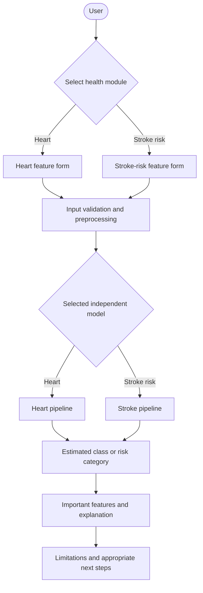
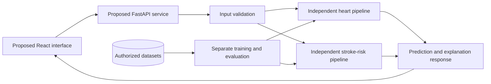

# NiraVed

**Know Your Care Before You Pay.**


> **Educational research prototype only. NiraVed is not a medical device and does not diagnose, prevent, or treat disease.**

## Live Demo

- Frontend: https://niraved-frontend.onrender.com
- Backend API docs: https://niraved-backend.onrender.com/docs

> Note: free tier sleeps after 15 min inactivity; first request may take ~50s.

## Contents

- [Executive summary](#executive-summary)
- [Problem statement](#problem-statement)
- [Proposed solution](#proposed-solution)
- [Scope and selected health domains](#scope-and-selected-health-domains)
- [Core features and workflow](#core-features-and-workflow)
- [Proposed architecture](#proposed-architecture)
- [Independent ML pipelines](#independent-ml-pipelines)
- [Dataset strategy](#dataset-strategy)
- [Model training and evaluation](#model-training-and-evaluation)
- [Explainable AI](#explainable-ai)
- [Technology stack](#technology-stack)
- [Repository structure](#repository-structure)
- [Setup and current status](#setup-and-current-status)
- [Validation strategy](#validation-strategy)
- [Responsible AI, privacy, and limitations](#responsible-ai-privacy-and-limitations)
- [Team and work division](#team-and-work-division)
- [Roadmap](#roadmap)
- [Future scope](#future-scope)
- [Research references](#research-references)
- [License](#license)

## Executive summary

NiraVed is a modular, explainable AI/ML healthcare research prototype for exploring health risks from structured inputs. The first version is deliberately limited to two independently developed classification modules:

| Module | Research target | Input |
|---|---|---|
| Heart disease | The heart-disease label defined by the verified selected dataset | Structured clinical and demographic features |
| Stroke risk | Stroke-risk classification defined by the verified selected dataset | Structured demographic, lifestyle, and clinical features |

Each module will follow literature review, dataset verification, leakage-safe preprocessing, baseline comparison, model evaluation, calibration checks, and explainability review before any application integration. No model metrics, deployment, working interface, or clinical effectiveness are claimed at this planning stage.

## Problem statement

People may face uncertainty when deciding whether to seek care. A system that predicts every disease would be too broad to evaluate credibly in a student project. NiraVed therefore investigates a bounded question:

> Can carefully evaluated tabular ML pipelines classify dataset-defined heart-disease and stroke-risk outcomes from structured features and communicate their limitations clearly?

The project is about reproducible research and responsible communication, not diagnosis or replacement of a healthcare professional.

## Proposed solution

The planned user experience is:

1. Select the heart or stroke-risk module.
2. Enter the structured features required by that module.
3. Validate the inputs before inference.
4. Run only the selected module's independent pipeline.
5. Present an estimated class or risk category with important model features.
6. Show uncertainty, limitations, and appropriate next-step guidance.

Medical-report OCR, treatment-cost estimates, hospital recommendations, insurance guidance, and additional disease modules are future scope, not current features.

## Scope and selected health domains

### Heart disease

The heart module will predict only the target label defined by its verified dataset. It will not be described as a detector for every cardiovascular disease.

### Stroke risk

The second module will address stroke-risk classification from structured tabular data. It is not a brain-tumour detector, MRI model, or universal brain-disease detector. The final feature list and label definition will be documented after dataset selection.

The two-domain scope supports independent evaluation, shared tooling where appropriate, and a manageable research contribution for a four-person B.Tech mini project.

## Core features and workflow

### Planned MVP

| Feature | Status |
|---|---|
| Independent heart-disease classification pipeline | Planned |
| Independent stroke-risk classification pipeline | Planned |
| Baseline and candidate model comparison | Planned |
| Leakage-safe preprocessing and imbalance handling | Planned |
| Explainability using SHAP or a justified alternative | Planned |
| Input validation and responsible-use messaging | Planned |
| Simple interface and API after model readiness | Planned |

### Proposed workflow



The workflow remains proposed until the corresponding software is implemented and tested.

## Proposed architecture



The application is intended to use validated schemas and stateless prediction requests. No database is required for the MVP; avoiding storage of user inputs is the default design. The architecture is documented in [docs/system-design.md](docs/system-design.md).

## Independent ML pipelines

Each module will independently follow:

1. Dataset and label verification.
2. Data understanding and exploratory analysis.
3. Leakage-safe preprocessing.
4. Train/validation/test strategy.
5. Majority-class and simple model baselines.
6. Candidate comparison and tuning.
7. Evaluation and calibration checks.
8. Explainability review.
9. A reproducible experiment report.

Heart and stroke experiments, thresholds, reports, and model artifacts must remain separate. A weak result in one module must not be hidden by results from the other module.

### Heart pipeline

Candidate work includes missing-value review, categorical encoding, scaling where required, baseline comparison, model selection, and evaluation using precision, recall/sensitivity, specificity, F1-score, confusion matrix, and ROC-AUC where appropriate.

### Stroke-risk pipeline

Candidate work includes missing-value handling, categorical encoding, stratified splitting, and class-imbalance safeguards. Class weights or resampling such as SMOTE may be compared, but resampling must occur only inside training folds. Precision, recall, F1-score, precision-recall curves/area, ROC-AUC, and confusion matrices are more informative than accuracy alone for an imbalanced target.

## Dataset strategy

No dataset has been finalized. Before use, the team will record:

- Original source, provenance, licence or terms, and collection method.
- Target definition, feature dictionary, population, and sample counts.
- Missing values, duplicates, possible leakage, and known limitations.
- The exact transformations required for reproducibility.

Raw data must remain immutable. Patient records, restricted datasets, large data files, and secrets must not be committed. Candidate datasets mentioned during planning are examples only until verified and documented in [data/README.md](data/README.md). The heart and stroke datasets will not be mixed.

## Model training and evaluation

The evaluation plan includes:

| Area | Planned approach |
|---|---|
| Splitting | Hold out a final test set and use stratified cross-validation or a validation split for selection and tuning |
| Leakage prevention | Fit imputers, encoders, scalers, feature selection, and resampling only on training folds inside pipelines |
| Baselines | Majority-class predictor and a simple model such as logistic regression |
| Metrics | Accuracy, precision, recall/sensitivity, specificity, F1-score, ROC-AUC, precision-recall area where appropriate, and confusion matrix |
| Thresholds | Select on validation data and document the recall/precision trade-off; do not tune on the final test set |
| Calibration | Review calibration curves and Brier score before describing scores as probabilities |
| Reporting | Include fold variation, class counts, limitations, and subgroup analysis where the data supports it |

A high accuracy from one split is not sufficient evidence. Dataset performance does not establish generalization to another population or clinical validity.

## Explainable AI

The planned result may include:

- An estimated class or carefully worded risk category.
- Features that most influenced the model output.
- A concise plain-language explanation.
- Uncertainty and model limitations.

SHAP is planned where suitable. Logistic-regression coefficients or permutation importance may be more appropriate for some comparisons. Feature importance describes model behavior, not causes of disease. Explanations can be unstable with correlated features or small datasets and must not make a weak or biased model appear trustworthy.

## Technology stack

| Layer | Planned technology |
|---|---|
| Language | Python |
| Data and ML | pandas, NumPy, scikit-learn |
| Backend | FastAPI and Pydantic |
| Frontend | React |
| Imbalance handling | imbalanced-learn where justified |
| Explainability | SHAP or a documented alternative |
| Visualization | matplotlib and seaborn |
| Model persistence | joblib |
| Testing | pytest |
| Database | None for the MVP |

These are proposed dependencies. They are listed in [requirements.txt](requirements.txt), but the project does not yet claim a verified runtime environment.

## Repository structure

The current repository is a planning and package scaffold:

```text
.
├── README.md
├── LICENSE
├── requirements.txt
├── CONTRIBUTING.md
├── data/
│   ├── README.md
│   ├── raw/.gitkeep
│   └── processed/.gitkeep
├── models/.gitkeep
├── notebooks/README.md
├── src/niraved/
│   ├── __init__.py
│   ├── common/
│   ├── explainability/
│   ├── heart/
│   └── stroke/
├── tests/README.md
├── docs/
│   ├── project-requirements.md
│   ├── system-design.md
│   ├── user-stories.md
│   ├── team-work-division.md
│   ├── implementation-roadmap.md
│   └── research/
└── .github/
    ├── PULL_REQUEST_TEMPLATE.md
    └── ISSUE_TEMPLATE/task.md
```

The package initializer files establish package locations only; they do not contain training or inference implementations. Large datasets, trained models, caches, and generated outputs are excluded from Git.

## Setup and current status

The repository currently contains planning documentation and package placeholders, not an executable application or training pipeline.

```bash
python -m venv .venv
# Windows PowerShell:
.venv\Scripts\Activate.ps1
python -m pip install -r requirements.txt
```

There is currently no application command or trained model to run. Do not obtain or use a dataset until its source and terms have been reviewed and recorded.

## Validation strategy

Planned checks include preprocessing and input-validation unit tests, leakage checks, reproducibility checks, module-specific evaluation tests, API contract tests if the service is built, and a usability review of safety messaging. See [tests/README.md](tests/README.md) and [docs/implementation-roadmap.md](docs/implementation-roadmap.md).

## Responsible AI, privacy, and limitations

NiraVed is an educational research prototype, not a medical diagnostic service. A low estimated risk must never be used to rule out a serious condition, and urgent symptoms require prompt professional care regardless of model output.

Public datasets may be small, old, imbalanced, biased, or unrepresentative. Dataset performance does not establish clinical validity. The project should avoid collecting or storing identifiable health information, minimize inputs, avoid logging health data, protect secrets, and document data handling. No regulatory compliance or clinical validation is claimed.

## Team and work division

The team has four members. Names can be added after confirmation; the role allocation below assigns one member to model training and distributes the remaining responsibilities across the other three members.

| Team member | Primary responsibility | Work division |
|---|---|---|
| Member 1 | Model training lead | Build and train both independent heart and stroke-risk pipelines; implement preprocessing, baselines, candidate models, tuning, evaluation, and model-artifact documentation. |
| Member 2 | Research and data lead | Conduct literature review; verify dataset provenance, licences, labels, and data dictionaries; document data limitations and maintain research sources. |
| Member 3 | Explainability, evaluation, and testing lead | Review SHAP and alternative explanation methods; define evaluation/reporting conventions with Member 1; create tests, review leakage and calibration evidence, and check responsible-use wording. |
| Member 4 | Application and integration lead | Define proposed input/output contracts; prepare the FastAPI and React integration plan; maintain repository workflow, integration checks, and final presentation materials. |

All members share requirements review, peer review, documentation, testing, privacy review, and final presentation. Member 1 must not claim model performance until the data and evaluation evidence have been reviewed by Members 2 and 3. Member 4 integrates models only after their feature schemas and artifacts are documented.

The provisional detailed allocation is tracked in [docs/team-work-division.md](docs/team-work-division.md) and should be updated with real names and approved assignments before implementation begins.

## Roadmap

| Phase | Work | Status |
|---|---|---|
| 0. Scope | Confirm targets, requirements, faculty decisions, and team allocation | In progress / approval pending |
| 1. Research and data | Review literature and verify datasets, labels, and terms | Planned |
| 2. Model training | Build and evaluate independent heart and stroke-risk pipelines | Planned |
| 3. Explainability and testing | Review explanations, leakage, calibration, safety, and reproducibility | Planned |
| 4. Application | Implement proposed API and interface after model readiness | Planned |
| 5. Reporting | Prepare the final report and presentation using recorded evidence | Planned |

Update a status only when its supporting evidence exists. No dataset metrics, deployment URL, screenshot, or test result is claimed in this README.

## Future scope

Future work may examine:

- Medical-report and prescription OCR.
- Treatment-cost estimation.
- Hospital recommendations.
- Insurance claim and policy guidance.
- Multilingual support.
- Ambulance and doctor-availability integrations.
- Additional prediction modules.
- Independent datasets and clinical collaboration.

Each addition requires separate data, evaluation, privacy, and safety decisions.

## Research references

These are methodological starting points, not NiraVed findings. Verify citations against authoritative sources before adding them to the formal report:

- Pedregosa, F. et al. (2011). [Scikit-learn: Machine Learning in Python](https://jmlr.org/papers/v12/pedregosa11a.html). *Journal of Machine Learning Research*, 12(85), 2825–2830.
- Lundberg, S. M. and Lee, S.-I. (2017). [A Unified Approach to Interpreting Model Predictions](https://proceedings.neurips.cc/paper_files/paper/2017/hash/8a20a8621978632d76c43dfd28b67767-Abstract.html). *Advances in Neural Information Processing Systems 30*.
- Saito, T. and Rehmsmeier, M. (2015). [The Precision-Recall Plot Is More Informative than the ROC Plot When Evaluating Binary Classifiers on Imbalanced Datasets](https://doi.org/10.1371/journal.pone.0118432). *PLOS ONE*, 10(3), e0118432.

Use the [literature review template](docs/research/literature-review-template.md) for additional sources. Do not report a paper's conclusion as a NiraVed result.

## License

This project is licensed under the MIT License. See [LICENSE](LICENSE) for the full text.
