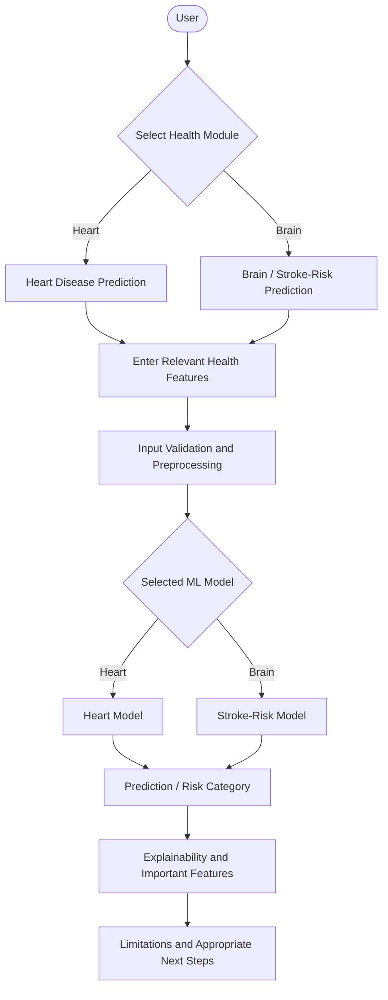
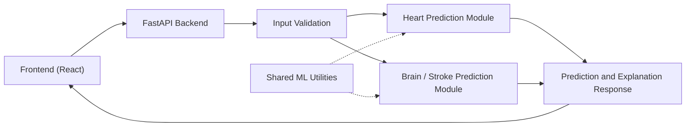

[README (2).md](https://github.com/user-attachments/files/33390546/README.2.md)
# NiraVed

**Know Your Care Before You Pay.**

> A modular, explainable AI/ML healthcare research prototype that helps people understand health risk from structured inputs, so they can make more informed decisions about seeking care.


> ⚠️ **NiraVed is a research and educational prototype. It is not a medical device and does not provide medical diagnoses.** See [Responsible AI, Privacy and Limitations](#16-responsible-ai-privacy-and-limitations).

---

## Table of Contents

1. [Project Title and Tagline](#niraved)
2. [Executive Summary](#2-executive-summary)
3. [Problem Statement](#3-problem-statement)
4. [Proposed Solution](#4-proposed-solution)
5. [Why Two Selected Health Domains?](#5-why-two-selected-health-domains)
6. [Core Features](#6-core-features)
7. [User Workflow](#7-user-workflow)
8. [System Architecture](#8-system-architecture)
9. [Heart Prediction Pipeline](#9-heart-prediction-pipeline)
10. [Brain / Stroke Prediction Pipeline](#10-brain--stroke-prediction-pipeline)
11. [Dataset Strategy](#11-dataset-strategy)
12. [Model Training and Evaluation](#12-model-training-and-evaluation)
13. [Explainable AI](#13-explainable-ai)
14. [Technology Stack](#14-technology-stack)
15. [Repository Structure](#15-repository-structure)
16. [Responsible AI, Privacy and Limitations](#16-responsible-ai-privacy-and-limitations)
17. [Implementation Roadmap](#17-implementation-roadmap)
18. [Future Scope](#18-future-scope)
19. [Research References](#19-research-references)

---

## 2. Executive Summary

Many people face a health concern without a clear way to judge how worrying it is. NiraVed's long-term vision is a healthcare decision-support platform that helps people understand their health risk, likely next steps and the financial side of care.

Predicting diseases across the entire human body would be broad and very hard to validate. On the advice of our project guide, **the first version of NiraVed is deliberately narrowed to two well-defined machine-learning modules:**

| Module | Prediction target | Data type |
|---|---|---|
| **A. Heart Disease Prediction** | Presence or absence of heart disease, as defined by the selected dataset's target label | Structured clinical and demographic features |
| **B. Brain / Stroke-Risk Prediction** | Stroke-risk classification (stroke vs. no stroke in the selected dataset) | Structured demographic, lifestyle and clinical features |

Each module is developed as a research pipeline: literature review, dataset selection, preprocessing, baseline, model comparison, tuning, multi-metric evaluation and explainability, and only then integrated into a simple web interface.

**What NiraVed is not:** a diagnostic tool, a replacement for clinical examination, a universal disease detector, a brain-tumour detector or an MRI/imaging model. Module A does not diagnose every cardiovascular disease, and Module B does not detect brain disease in general.

**Current stage:** planning and design. No model metrics, deployment or test results are reported in this document because experiments have not yet been completed (see [Implementation Roadmap](#17-implementation-roadmap)).

---

## 3. Problem Statement

Healthcare decisions often begin with uncertainty: *Is this serious? Should I see a doctor? What should I understand about my risk?* Cost anxiety and information asymmetry can delay care-seeking, particularly where out-of-pocket spending is high.

Cardiovascular disease and stroke are two conditions where early awareness of risk factors matters. Many risk factors, such as age, blood pressure, glucose level, smoking status and body-mass index, can be captured as structured data, which makes these conditions suitable for a bounded, measurable ML study.

The problem NiraVed addresses in its first version is therefore deliberately specific:

> *Can a transparent, well-evaluated ML pipeline estimate heart-disease presence and stroke risk from structured health features, and explain its output to a non-expert user, while being honest about its limitations?*

---

## 4. Proposed Solution

NiraVed offers a simple web application in which a user selects a health module, enters the relevant features, and receives:

1. A predicted class or risk category.
2. The features that contributed most to that output.
3. A concise plain-language explanation.
4. Limitations, uncertainty and appropriate next steps.

The ML modules are developed and evaluated **independently**, so each can be tested, retrained and improved without affecting the other. Healthcare-navigation features from the original NiraVed concept (cost estimation, hospital recommendation, insurance guidance) are retained as **future scope** and are not part of the first version's research contribution.

---

## 5. Why Two Selected Health Domains?

| Reason | Explanation |
|---|---|
| **Validation feasibility** | A system covering all diseases cannot be meaningfully validated by a student team. Two bounded targets can be studied rigorously. |
| **Structured data availability** | Public structured datasets exist for heart disease and stroke risk, supporting reproducible tabular-ML work. These must still be verified for provenance and licensing (see [Dataset Strategy](#11-dataset-strategy)). |
| **Public health relevance** | Cardiovascular disease and stroke are major health concerns, and their risk factors overlap, so the two modules share preprocessing and explainability tooling. |
| **Methodological depth** | Focusing on two targets allows proper baselines, model comparison, imbalance handling, calibration and explainability instead of a shallow demo. |
| **Modularity** | A clean two-module design demonstrates an architecture that can later accept more modules. |

**Why stroke risk as the brain module?** Stroke is a brain-related condition with a clearly defined binary label in structured datasets. Alternatives such as brain-tumour detection or neurodegenerative-disease classification generally require medical imaging or specialised clinical data, which increases the difficulty of data handling, modelling and validation. If the team's existing materials or supervisor guidance support a different brain-related target, that target must be explicitly defined, with its trade-offs documented, before work begins.

> A structured stroke-risk model is **not** a brain-tumour detector, an MRI diagnostic model or a universal brain-disease detector.

---

## 6. Core Features

### Core MVP

| Feature | Description | Status |
|---|---|---|
| Heart disease prediction | Classification of heart-disease presence per the selected dataset's label | Planned |
| Stroke-risk prediction | Stroke-risk classification from structured features | Planned |
| Model evaluation and comparison | Baseline vs. multiple models, multiple metrics, separate per module | Planned |
| Explainability | Feature-contribution explanations (for example SHAP, where suitable) | Planned |
| Simple user interface | Module selection, feature entry, result display | Planned |
| Input validation and responsible-use information | Range and type checks, disclaimers, next-step guidance | Planned |

### Secondary / Future Scope

| Feature | Status |
|---|---|
| Medical report and prescription OCR | Future |
| Treatment cost estimation | Future |
| Hospital recommendations | Future |
| Insurance claim and policy guidance | Future |
| Multilingual support | Future |
| Ambulance and doctor availability integrations | Future |

Details are in [Future Scope](#18-future-scope).

---

## 7. User Workflow

The primary workflow uses **structured data entry only**. Uploading medical reports is *not* required.



Report OCR and medical-document understanding are a **later enhancement** and not part of this workflow in the first version.

---

## 8. System Architecture

The architecture is intentionally small and modular. It avoids microservices and extra infrastructure that the project does not need.



### Component Responsibilities

| Component | Responsibility |
|---|---|
| **Frontend (React)** | Module selection, feature input forms, result and explanation display, disclaimers. |
| **FastAPI backend** | Receives requests, routes them to the correct module, returns structured responses. |
| **Input validation** | Checks types, allowed ranges and required fields (for example Pydantic schemas) before any model is called. |
| **Heart prediction module** | Loads the trained heart model and its preprocessing pipeline, returns prediction and explanation data. |
| **Brain / stroke prediction module** | Same contract as the heart module, with its own model, preprocessing and threshold. |
| **Shared ML utilities** | Reusable code for metrics, plotting, calibration, explanation and preprocessing helpers. |
| **Response builder** | Combines prediction, important features, explanation text and limitations into one response. |

### Independent Testing and Improvement

Both modules follow the same interface (validated input → prediction + explanation), but own their data, preprocessing, model artefacts, threshold and evaluation report. This means:

- Each model can be retrained, replaced or re-tuned without touching the other.
- Each module has its own unit tests and evaluation notebook.
- A weak result in one module does not block progress on the other.

### Database

**No database is required for the MVP.** Predictions can be computed statelessly, and no user medical data needs to be stored. A database (for example PostgreSQL, as in the original design) should be introduced only if a genuine requirement appears, such as user accounts or saved history, and then with explicit consent and a retention policy.

---

## 9. Heart Prediction Pipeline

**Target:** a heart-disease classification label as defined by the selected dataset (for example presence vs. absence of heart disease). The module does not diagnose every cardiovascular disease.

```mermaid
flowchart LR
    A[Dataset Selection] --> B[Data Understanding]
    B --> C[Cleaning and Missing-Value Handling]
    C --> D[Exploratory Data Analysis]
    D --> E[Feature Selection / Importance]
    E --> F[Baseline Model]
    F --> G[Model Comparison]
    G --> H[Hyperparameter Tuning]
    H --> I[Evaluation and Calibration]
    I --> J[Explainability]
    J --> K[Export Model for Backend]
```



| Stage | Plan |
|---|---|
| **Input features** | Those supported by the selected dataset. Heart-disease datasets commonly include age, sex, chest-pain type, resting blood pressure, cholesterol, fasting blood sugar, resting ECG result, maximum heart rate, exercise-induced angina and ST-depression-related measures. The final list is fixed only after the dataset is chosen and its data dictionary reviewed. |
| **Preprocessing** | Inspect missing values and impossible values (for example zero cholesterol or blood pressure). Choose imputation per feature with justification (median/mode or model-based), encode categoricals, scale where the model needs it. All steps are fitted on training data only, inside a pipeline. |
| **EDA** | Class balance, feature distributions, correlations, outliers, and differences across subgroups such as sex and age bands. |
| **Feature selection / importance** | Compare correlation analysis, model-based importance and permutation importance. Retain features based on evidence and clinical plausibility, not only statistical score. |
| **Models** | A simple baseline (majority class and logistic regression), then candidates such as logistic regression, k-nearest neighbours, support vector machine, decision tree, random forest and gradient boosting. The final choice is made from experiments. |
| **Evaluation** | Accuracy, precision, recall, F1-score, confusion matrix, sensitivity, specificity and ROC-AUC (see [Section 12](#12-model-training-and-evaluation)). |
| **Explainability** | SHAP, if suitable for the selected model (see [Section 13](#13-explainable-ai)). |
| **Limitations** | Dataset size, source population, label definition, possible bias and generalization concerns are documented in the module report. |

---

## 10. Brain / Stroke Prediction Pipeline

**Target:** stroke-risk classification (stroke vs. no stroke) from a suitable structured dataset. This is a *risk classification* on tabular data, not a diagnosis, and not an imaging model.

```mermaid
flowchart LR
    A[Dataset Selection] --> B[Data Understanding]
    B --> C[Cleaning and Missing-Value Handling]
    C --> D[Exploratory Data Analysis]
    D --> E[Class-Imbalance Strategy]
    E --> F[Baseline Model]
    F --> G[Model Comparison]
    G --> H[Hyperparameter and Threshold Tuning]
    H --> I[Evaluation and Calibration]
    I --> J[Explainability]
    J --> K[Export Model for Backend]
```



| Stage | Plan |
|---|---|
| **Dataset and features** | A structured stroke dataset with features such as age, hypertension, heart disease, average glucose level, BMI, smoking status, gender, marital status, work type and residence type (as commonly found in public stroke datasets). Final features depend on the verified dataset. Features with ethical or fairness concerns are reviewed before inclusion. |
| **Preprocessing** | Handle missing values (BMI is commonly incomplete in such datasets), encode categoricals, scale where required. Fit all transformations on training data only. |
| **Class imbalance** | Stroke-positive cases are typically rare. Planned options: class weights, stratified splits, and resampling (such as SMOTE) applied **only inside training folds**. Compare these against the unaltered baseline. |
| **Models** | Baseline plus candidates such as logistic regression, random forest and gradient boosting. Chosen from experiments. |
| **Metrics** | Emphasis on recall (sensitivity), precision and F1-score, plus precision-recall curve, ROC-AUC and confusion matrix. Accuracy alone is misleading on imbalanced data. |
| **Explainability** | Important contributing features per prediction and globally, with the caution that they are associations, not causes. |
| **Limitations** | Dataset provenance, small number of positive cases, self-reported or coarse features, and limited generalization are documented. Output is described as a **risk estimate** only. |

---

## 11. Dataset Strategy

No dataset has been finalized yet. The project will follow the steps below.

1. **Shortlist** publicly available datasets for each module from established repositories (for example the UCI Machine Learning Repository or Kaggle).
2. **Verify** provenance, licence, collection method, size, label definition and known issues. Datasets of unclear origin must be treated cautiously and the concern recorded.
3. **Document** every chosen dataset in `data/README.md` or `docs/data/` with a data dictionary, source link, licence and known limitations.
4. **Keep raw data immutable**; all cleaning is done by versioned scripts.

| Item | Heart module | Brain / stroke module |
|---|---|---|
| Candidate source | To be selected (for example a UCI-hosted heart-disease dataset) | To be selected (for example a public structured stroke-risk dataset) |
| Verified provenance and licence | To be completed | To be completed |
| Final feature list | To be completed | To be completed |
| Known limitations | To be documented | To be documented |

> Candidate datasets named above are examples only. They are **not** confirmed choices, and no dataset statistics are claimed here.

Datasets are never mixed across the two modules.

---

## 12. Model Training and Evaluation

### Why model comparison and multiple metrics?

A single high accuracy from one experiment says little. It can result from class imbalance (a model that always predicts "no stroke" can look accurate), data leakage, a lucky split or overfitting. Comparing models against a simple baseline, using cross-validation and reporting several metrics shows whether a model is genuinely better and what kinds of errors it makes. In a health context, a **missed positive case** and a **false alarm** have very different consequences, so these must be reported separately.

### Evaluation strategy

| Aspect | Approach |
|---|---|
| **Data splitting** | Hold out a final **test set** that is used once. Use stratified k-fold cross-validation (or a train/validation split) on the remaining data for model selection and tuning. |
| **Data leakage prevention** | Fit imputers, scalers, encoders, feature selectors and resamplers **only on training folds** using scikit-learn pipelines. Remove duplicates before splitting. Never tune on the test set. Review features that may encode the label. |
| **Imbalanced classes** | Stratified splitting, class weights, and resampling inside training folds only. Evaluate using recall, precision, F1 and precision-recall curves, not accuracy alone. |
| **Baselines** | Majority-class predictor and logistic regression. Every complex model must be compared with these. |
| **Metrics** | Accuracy, precision, recall (sensitivity), specificity, F1-score, ROC-AUC, precision-recall AUC (especially for stroke) and confusion matrix. Report variation across folds, not only the mean. |
| **Threshold selection** | The default 0.5 threshold is not assumed to be appropriate. Choose thresholds on validation data according to the recall/precision trade-off, favouring sensitivity for screening-style use, and document the reasoning. |
| **Calibration** | Check calibration curves and Brier score. Apply calibration (for example Platt scaling or isotonic regression) if needed. Until calibration is shown, outputs are called **risk scores or categories**, not probabilities or confidence. |
| **Separate evaluation** | Heart and brain modules have separate experiments, thresholds, reports and model artefacts. |

### Three levels of evidence

| Level | Meaning | In this project |
|---|---|---|
| **1. Dataset performance** | Results on held-out data drawn from the same dataset | Will be measured and reported honestly |
| **2. Generalization to unseen data** | Performance on data from different sources or populations | Only claimed if an independent dataset is actually used. Otherwise stated as untested |
| **3. Clinical validation** | Prospective or retrospective validation in real clinical settings with proper oversight | **Outside the scope** of this student prototype |

> No accuracy or other performance figure is promised in advance. Results will be reported in `docs/research/` only after experiments are completed.

---

## 13. Explainable AI

The interface aims to show users:

| Element | Description |
|---|---|
| **Predicted class / risk category** | For example "higher estimated risk" or "lower estimated risk", worded carefully and never as a diagnosis. |
| **Important contributing features** | The features that most influenced this prediction, with direction of influence. |
| **Concise explanation** | A short plain-language summary of the model output. |
| **Limitations and uncertainty** | Reminder of dataset limits, model error rates and what the model cannot capture. |

**Method.** SHAP is planned where suitable for the selected model (it works well with tree-based models, and with linear models). Simpler options such as logistic-regression coefficients and permutation importance can supplement it. The method chosen will be justified in the module report.

**Interpretation rules**

- Feature importance describes what the *model* relies on, **not what causes disease**.
- Explanations can be unstable with correlated features and small datasets.
- Explanations must never make a model appear more reliable than its evaluation supports.

---

## 14. Technology Stack

| Layer | Technology | Rationale |
|---|---|---|
| Frontend | React | Retained from original design; suited to a form-based, result-display interface |
| Backend | FastAPI (Python) | Retained; async, auto-generated API docs, natural fit with the Python ML stack |
| Language | Python | ML, data analysis and backend in one language |
| Data and ML | pandas, NumPy, scikit-learn | Standard, well-documented tabular-ML tooling |
| Gradient boosting (optional) | XGBoost or LightGBM | Strong tabular baselines to compare against |
| Imbalance handling | imbalanced-learn | Resampling inside cross-validation pipelines |
| Explainability | SHAP | Feature-level explanations where suitable |
| Visualization | matplotlib / seaborn | EDA, ROC, precision-recall and calibration plots |
| Validation | Pydantic | Input schemas in FastAPI |
| Model persistence | joblib | Saving trained pipelines |
| Testing | pytest | Backend and ML utility tests |
| Database | None for MVP | Added only if a real requirement appears (for example PostgreSQL, as in the original design) |

---

## 15. Repository Structure

Proposed structure (to be created as the project proceeds):

```text
niraved/
├── frontend/                  # React application
│   └── src/
├── backend/                   # FastAPI application
│   ├── app/
│   │   ├── main.py
│   │   ├── routers/           # /heart and /stroke endpoints
│   │   ├── schemas/           # Pydantic input/output models
│   │   └── services/          # Load models, build responses
│   └── requirements.txt
├── ml/
│   ├── heart/                 # Heart disease module
│   │   ├── notebooks/         # EDA and experiments
│   │   ├── src/               # Training and evaluation scripts
│   │   └── models/            # Saved model artefacts (small files only)
│   ├── brain_stroke/          # Brain / stroke-risk module
│   │   ├── notebooks/
│   │   ├── src/
│   │   └── models/
│   └── shared/                # Shared ML utilities (metrics, plots, calibration, SHAP helpers)
├── data/                      # Data documentation (raw data kept out of Git if large or restricted)
│   └── README.md              # Sources, licences, data dictionaries, limitations
├── tests/
│   ├── backend/
│   └── ml/
├── docs/
│   ├── research/              # Literature notes, experiment reports
│   └── architecture/          # Architecture diagrams and design decisions
├── assets/
│   └── screenshots/           # Added only once real screenshots exist
├── .gitignore
└── README.md
```

| Folder | Purpose |
|---|---|
| `frontend/` | User interface |
| `backend/` | API, validation, routing, response building |
| `ml/heart/`, `ml/brain_stroke/` | Independent training, evaluation and model export per module |
| `ml/shared/` | Code reused by both modules |
| `data/` | Dataset documentation and (where permitted) data |
| `tests/` | Backend and ML tests |
| `docs/` | Research notes, reports and architecture documentation |
| `assets/` | Images and screenshots |

---

## 16. Responsible AI, Privacy and Limitations

### Safeguards

- **NiraVed is not a medical diagnostic tool.** All outputs are research-prototype estimates.
- **Predictions do not replace** clinical examination or professional medical advice.
- **A low model score must never be used to rule out a serious condition.** Models can and do miss cases.
- **Potential emergency symptoms require urgent professional assessment regardless of model output.** For example, sudden weakness or numbness on one side, facial droop, speech difficulty, sudden severe headache, chest pain, or severe breathlessness. The interface will display an emergency notice prominently, independent of any prediction.
- **Personal medical information must be protected.** The MVP should avoid storing user inputs by default, use HTTPS, and log no identifiable health data.
- **No real clinical decision-making** should be based on these models without appropriate validation, regulatory review and clinical oversight.

### Known limitations

| Limitation | Implication |
|---|---|
| Public datasets may be small, old or from limited populations | Results may not transfer to other populations, including users in India |
| Label definitions are dataset-specific | The heart label is not a full cardiovascular diagnosis |
| Possible dataset bias (age, sex, geography, collection setting) | Performance may differ across subgroups, so subgroup analysis is planned |
| Class imbalance in stroke data | Few positive cases give uncertain recall estimates |
| Self-reported or coarse features | Input quality affects output quality |
| Feature importance is not causation | Explanations must not be read as medical reasons |
| No clinical validation | Dataset performance is not clinical performance |
| Model scores are not calibrated by default | They are not described as probabilities until calibration is checked |

### Privacy and data handling

- Collect only the features the models need.
- Do not store inputs unless a documented requirement and user consent exist.
- If accounts or history are added later, use encryption in transit and at rest, a retention policy and deletion on request.
- Compliance frameworks (for example HIPAA-aligned or ABDM-aligned handling) are a long-term target, **not a current certification**.

---

## 17. Implementation Roadmap

Implementation status is not confirmed in the existing project material, so all items below are marked as **Planned** or **To be implemented** until completed. Update this table as work progresses.

| Phase | Work item | Status |
|---|---|---|
| **0. Scoping** | Narrow scope to heart + stroke-risk modules; revise README | Done (this document) |
| **1. Research** | Literature review for both modules | Planned |
| **1. Research** | Dataset shortlist, provenance and licence verification | Planned |
| **2. Heart module** | Preprocessing, EDA, baseline | To be implemented |
| **2. Heart module** | Model comparison, tuning, evaluation, calibration | To be implemented |
| **2. Heart module** | Explainability (SHAP or alternative) | To be implemented |
| **3. Brain module** | Preprocessing, EDA, imbalance strategy, baseline | To be implemented |
| **3. Brain module** | Model comparison, threshold tuning, evaluation, calibration | To be implemented |
| **3. Brain module** | Explainability | To be implemented |
| **4. Application** | FastAPI backend with validation and prediction endpoints | To be implemented |
| **4. Application** | React interface with results and disclaimers | To be implemented |
| **5. Testing** | Unit, API and ML pipeline tests; usability checks | To be implemented |
| **5. Documentation** | Experiment reports, final project report | To be implemented |

### Status summary

| Category | Items |
|---|---|
| **Implemented** | Project scope and design documentation only |
| **Under development** | None confirmed (update when work begins) |
| **Planned** | All Core MVP features listed in [Section 6](#6-core-features) |
| **Future scope** | See [Section 18](#18-future-scope) |

No datasets, metrics, APIs, deployment URLs, screenshots or test results are claimed at this stage.

---

## 18. Future Scope

These items come from the original NiraVed concept. They are **not implemented** and are not the research contribution of the current version.

| Area | Description |
|---|---|
| **Medical report and prescription OCR** | Extract structured data from reports (for example with Tesseract or a cloud OCR service) to pre-fill model inputs. Needs separate accuracy evaluation. |
| **Treatment cost estimation** | Range-based cost estimates scaled by city and hospital tier, which needs reliable pricing data. |
| **Hospital recommendations** | Explainable weighted ranking by specialization, cost, rating and distance. |
| **Insurance claim and policy guidance** | Plain-language explanation of claims, waiting periods and exclusions, framed as general guidance only. |
| **Multilingual support** | Regional Indian languages for wider accessibility. |
| **Ambulance and doctor availability integrations** | Real-time services that depend on external partnerships. |
| **Additional prediction modules** | Further disease areas, added one at a time under the same evaluation standards. |
| **Clinical collaboration and validation** | Evaluation with clinicians and independent datasets, a prerequisite for any real-world use. |

Insurance and healthcare navigation are envisioned as a later layer that can sit on top of validated prediction modules, under the original *"Know Your Care Before You Pay"* vision.

---

## 19. Research References

No findings or benchmark results are cited from memory as project outcomes. The list below gives **foundational methods references** for the techniques planned in this project. Please verify every citation (authors, year, venue) against the original source before including it in the final report, and add dataset and domain literature as the review progresses.

**Methods**

- Pedregosa, F. et al. (2011). *Scikit-learn: Machine Learning in Python.* Journal of Machine Learning Research, 12.
- Lundberg, S. M. and Lee, S.-I. (2017). *A Unified Approach to Interpreting Model Predictions.* Advances in Neural Information Processing Systems (NeurIPS).
- Chawla, N. V. et al. (2002). *SMOTE: Synthetic Minority Over-sampling Technique.* Journal of Artificial Intelligence Research, 16.
- Niculescu-Mizil, A. and Caruana, R. (2005). *Predicting Good Probabilities with Supervised Learning.* International Conference on Machine Learning (ICML).
- Saito, T. and Rehmsmeier, M. (2015). *The Precision-Recall Plot Is More Informative than the ROC Plot When Evaluating Binary Classifiers on Imbalanced Datasets.* PLOS ONE.

**Datasets (to be verified before use)**

- Detrano, R. et al. (1989). *International application of a new probability algorithm for the diagnosis of coronary artery disease.* American Journal of Cardiology. (Source study associated with commonly used UCI heart-disease data.)
- Stroke dataset citation: `[to be added after dataset selection and provenance check]`

**Domain literature (to be populated)**

- Heart-disease prediction using machine learning: `[placeholder]`
- Stroke-risk prediction using machine learning: `[placeholder]`
- Clinical decision support systems and responsible AI in healthcare: `[placeholder]`
- Calibration and clinical-prediction-model reporting guidelines: `[placeholder]`

---

*NiraVed is a B.Tech mini project: a focused, modular, explainable AI/ML healthcare research prototype with a realistic path toward a broader healthcare decision-support platform.*
