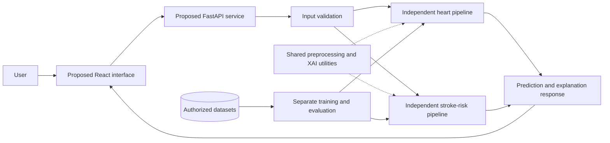

# NiraVed

**Know Your Care Before You Pay.**


> **Educational research prototype only. NiraVed is not a medical device and does not diagnose, prevent, or treat disease.**

## Contents

- [Overview](#overview)
- [Problem and research objective](#problem-and-research-objective)
- [Scope and intended use](#scope-and-intended-use)
- [Features and workflow](#features-and-workflow)
- [Architecture](#architecture)
- [Independent ML pipelines](#independent-ml-pipelines)
- [Datasets and methodology](#datasets-and-methodology)
- [Explainability](#explainability)
- [Technology](#technology)
- [Repository structure](#repository-structure)
- [Setup and current execution stage](#setup-and-current-execution-stage)
- [Validation strategy](#validation-strategy)
- [Responsible research, privacy, and limitations](#responsible-research-privacy-and-limitations)
- [Roadmap](#roadmap)
- [Future scope](#future-scope)
- [Research references](#research-references)
- [Team and contribution](#team-and-contribution)
- [License](#license)

## Overview

NiraVed is a modular, explainable AI/ML healthcare research prototype for exploring health risks from structured inputs. The B.Tech CSE mini project is in **planning and design**. The initial study is intentionally limited to two separately developed classification modules: heart disease and stroke risk. No model, API, working interface, deployment, or measured performance is currently claimed.

## Problem and research objective

People may face uncertainty when deciding whether to seek care, while a broad system that predicts many diseases would be difficult to evaluate credibly in a student project. NiraVed will investigate whether carefully evaluated tabular ML pipelines can classify dataset-defined heart disease and stroke-risk outcomes, and present their outputs and limitations in understandable language.

The research objective is to compare suitable baselines and candidate models for each target, evaluate their errors with appropriate metrics, and study whether explainability methods help communicate model behavior. Findings will be limited to the selected datasets and experimental design; they will not establish clinical effectiveness.

## Scope and intended use

| Module | Research target | Input |
|---|---|---|
| Heart disease | Target label defined by the verified selected dataset | Structured clinical and demographic features |
| Stroke risk | Stroke-risk classification defined by the selected dataset | Structured demographic, lifestyle, and clinical features |

The proposed audience is the student research team, faculty reviewers, and readers evaluating the methods. If eventually built, the interface is intended for educational exploration only. The stroke module is **not** a brain-tumour detector, MRI model, or universal brain-disease detector. See [project requirements](docs/project-requirements.md) and [user stories](docs/user-stories.md).

## Features and workflow

**Implemented:** repository planning and design documentation only. No predictive software is confirmed.

**Planned core work:** independent heart and stroke-risk experiments; data validation; model comparison; explainability where suitable; and a proposed React interface with a FastAPI service after models are evaluated.

**Future scope:** cost estimates, hospital recommendations, insurance guidance, medical-report analysis, multilingual support, and additional disease modules. These are not current features.

Proposed user flow: select a module → enter structured inputs → validate inputs → run the relevant independent model → present the estimated class/category and an explanation → show limitations and appropriate next steps. The workflow remains proposed until implemented and tested.

## Architecture

The following is a **proposed** architecture, not a description of deployed components.



The service is intended to use validated schemas and stateless prediction requests. Training and evaluation remain separate from inference. No database is currently proposed; avoiding storage of user inputs is the default design. Further detail and design limitations are in [system design](docs/system-design.md).

## Independent ML pipelines

Each module will independently follow: dataset and label verification → data understanding → preprocessing in leakage-safe pipelines → train/validation/test strategy → baseline → candidate comparison and tuning → evaluation and calibration checks → explainability review → documented experiment. The heart pipeline will predict only the heart dataset's defined target. The stroke pipeline will address class imbalance and will not be described as a general brain classifier.

## Datasets and methodology

No datasets have been finalized. Candidate sources mentioned during planning are examples only. Before use, record the original source, provenance, licence/terms, collection method, target definition, feature dictionary, population, and known limitations. Obtain data only from authorized sources. Do not commit patient records, restricted datasets, or large data files. Keep raw data immutable and document reproducible transformations; see [data guidance](data/README.md).

Use stratified splitting where appropriate and reserve a final test set. Fit imputers, encoders, scalers, feature selection, and any resampling only within training folds. Compare a simple baseline (including a majority-class baseline) with suitable models. Select thresholds on validation data, never on the final test set. Heart and stroke experiments, thresholds, reports, and model artifacts must remain separate.

Report precision, recall/sensitivity, specificity, F1-score, confusion matrix, and ROC-AUC where appropriate. For imbalanced stroke data, also report precision-recall curves/area and class counts; do not rely on accuracy alone. Include uncertainty or fold variation, calibration checks such as Brier score when scores are interpreted probabilistically, and subgroup analyses when data supports them. No performance figures are claimed in advance.

## Explainability

SHAP is a proposed method when appropriate to the selected models; coefficients or permutation importance may be more suitable for some comparisons. Document the method and its limitations. Feature contributions describe model behavior, not causes of disease, and an explanation does not make a weak or biased model trustworthy. See [research documentation](docs/research/README.md).

## Technology

The existing design proposes **Python** for ML and the backend, **pandas**, **NumPy**, and **scikit-learn** for tabular workflows, **FastAPI/Pydantic** for a future API, and **React** for a future interface. SHAP and matplotlib are proposed for explainability and plots. The UI framework and interfaces remain proposed. The root [requirements.txt](requirements.txt) lists a minimal Python proposal; no packages have been installed or compatibility verified as part of this setup.

## Repository structure

```text
.
├── README.md
├── LICENSE
├── .gitignore
├── requirements.txt
├── CONTRIBUTING.md
├── data/
│   ├── README.md
│   ├── raw/.gitkeep
│   └── processed/.gitkeep
├── notebooks/README.md
├── src/niraved/
│   ├── __init__.py
│   ├── common/__init__.py
│   ├── heart/__init__.py
│   ├── stroke/__init__.py
│   └── explainability/__init__.py
├── app/README.md
├── models/.gitkeep
├── tests/README.md
├── docs/
│   ├── project-requirements.md
│   ├── system-design.md
│   ├── user-stories.md
│   ├── team-work-division.md
│   ├── implementation-roadmap.md
│   └── research/
│       ├── README.md
│       └── literature-review-template.md
└── .github/
    ├── PULL_REQUEST_TEMPLATE.md
    └── ISSUE_TEMPLATE/task.md
```

Package initializer files establish Python package locations only; they contain no model implementation. Large datasets, trained models, caches, and generated outputs are excluded from Git.

## Setup and current execution stage

This repository currently contains planning materials and package placeholders, not an executable application or training pipeline. Python dependencies are proposed and not verified. To prepare a local environment when beginning implementation:

```bash
python -m venv .venv
# Windows PowerShell: .venv\Scripts\Activate.ps1
# macOS/Linux: source .venv/bin/activate
python -m pip install -r requirements.txt
```

There is currently no application command or model to run. Do not obtain or use a dataset until its source and terms have been reviewed and recorded in `data/README.md`.

## Validation strategy

Planned checks include unit tests for preprocessing and input validation; leakage checks; reproducibility checks; module-specific evaluation tests; API contract tests if the service is built; and usability review of disclaimers and explanations. Tests and application behavior are not yet implemented. See [tests/README.md](tests/README.md) and the [roadmap](docs/implementation-roadmap.md).

## Responsible research, privacy, and limitations

NiraVed is an educational research prototype, **not a medical device or diagnostic service**. Outputs must never replace professional assessment or be framed as guaranteed clinical outcomes. A low estimated risk must not be used to rule out illness; urgent symptoms require prompt professional care regardless of any model output.

Public datasets may be small, old, imbalanced, biased, or unrepresentative of intended users. Dataset performance does not establish generalization or clinical validity. Do not collect or store identifiable health information for this project without a justified, approved design and appropriate safeguards. Minimize inputs, avoid logging health data, protect secrets, and document data handling. No regulatory compliance or clinical validation is claimed.

## Roadmap

All work below is planned; there is no confirmed implementation beyond project scoping and documentation.

| Milestone | Status |
|---|---|
| Confirm scope and requirements with faculty/team | In progress / approval pending |
| Review literature and verify candidate datasets and terms | Planned |
| Build and evaluate heart pipeline independently | Planned |
| Build and evaluate stroke pipeline with imbalance safeguards | Planned |
| Review explanations, limitations, and reproducibility | Planned |
| Integrate proposed API and interface after model readiness | Planned |
| Validate, document, and prepare final report | Planned |

See the [detailed roadmap](docs/implementation-roadmap.md) for proposed milestones and evidence tracking.

## Future scope

Later work may examine medical-report analysis, cost estimation, hospital recommendations, insurance guidance, regional languages, external availability integrations, and additional prediction modules. These require separate data, evaluation, and safety decisions and are not part of the initial scope.

## Research references

These methodological references are starting points, not NiraVed findings. No domain papers or dataset citations are treated as verified project evidence at this stage.

- Pedregosa, F. et al. (2011). [Scikit-learn: Machine Learning in Python](https://jmlr.org/papers/v12/pedregosa11a.html). *Journal of Machine Learning Research*, 12(85), 2825–2830.
- Lundberg, S. M. and Lee, S.-I. (2017). [A Unified Approach to Interpreting Model Predictions](https://proceedings.neurips.cc/paper_files/paper/2017/hash/8a20a8621978632d76c43dfd28b67767-Abstract.html). *Advances in Neural Information Processing Systems 30*.
- Saito, T. and Rehmsmeier, M. (2015). [The Precision-Recall Plot Is More Informative than the ROC Plot When Evaluating Binary Classifiers on Imbalanced Datasets](https://doi.org/10.1371/journal.pone.0118432). *PLOS ONE*, 10(3), e0118432.

Verify citations against their original publication or an authoritative record when adding them to the formal review. Use the [literature review template](docs/research/literature-review-template.md), and do not report a paper's conclusion as a NiraVed result.

## Team and contribution

The provisional four-person allocation is in [team-work-division.md](docs/team-work-division.md). All members are expected to contribute to research, documentation, testing, and presentation. Follow [CONTRIBUTING.md](CONTRIBUTING.md) and use the repository's issue and pull-request templates. The current license is MIT; see [LICENSE](LICENSE).

## License

This project is licensed under the MIT License. See [LICENSE](LICENSE) for the full text.
