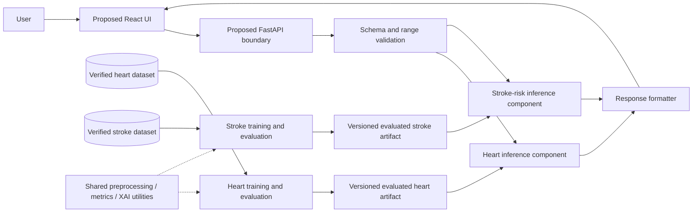

# System Design

## Status

This document describes the **proposed** design. Only repository planning documents and empty package initializers exist; there are no API endpoints, trained models, UI, or deployed services.

## High-level architecture

## Components and responsibilities

| Component | Proposed responsibility |
|---|---|
| React UI | Module selection, validated-form feedback, estimate and explanation display, safety notice |
| FastAPI boundary | Request routing, schema validation, safe errors, response contract |
| Heart research module | Heart-specific data preparation, training, evaluation, artifact metadata, inference adapter |
| Stroke research module | Stroke-specific preparation and imbalance-aware training, evaluation, metadata, inference adapter |
| Shared utilities | Reusable split-safe transformations, metric reporting, plotting, calibration and explanation helpers |
| Data documentation | Source/terms register, data dictionary, limitations; no sensitive records |
| Artifact metadata | Model version, training data reference, feature schema, threshold, evaluation report, dependency context |

No database is planned for the initial prototype. Inference should be stateless and avoid retaining user inputs.

## End-to-end flow

1. Researcher identifies a candidate source and verifies its terms, provenance, population, and label.
2. Raw permitted data remains immutable; versioned code prepares each module's data independently.
3. A training workflow uses train/validation folds for preprocessing, model selection, imbalance handling, and threshold selection.
4. An untouched test set supports final reporting. Explanations and limitations are evaluated and documented.
5. Only evaluated, versioned artifacts and their schemas are considered for integration.
6. A future UI submits structured values to a validated API boundary; the selected adapter loads its own artifact and returns an estimate and carefully worded explanation.
7. Errors return safe, non-sensitive messages. User data is not logged or persisted by default.

## Independent module pipelines

Heart and stroke each have a distinct target, schema, preprocessing, split strategy, baseline, candidate comparison, threshold, evaluation report, and artifact. Reuse code only for generic operations whose behavior has been checked for both datasets. For stroke, class weights or resampling may be compared; any resampling belongs inside training folds. Never transfer a threshold or performance result from one module to the other.

## Training and inference separation

Training is an offline research activity that records data version, code revision, random seed, dependencies, split protocol, selected threshold, metrics, and artifact identifier. Inference performs schema checks and uses a frozen artifact; it does not fit or tune. Artifacts remain local and ignored by Git unless a later, reviewed distribution policy permits a small non-sensitive artifact.

## Validation and error handling

Future input schemas should reject missing required fields, non-finite values, incorrect categories, and out-of-range values using dataset-informed rules. Validation errors must not echo sensitive values unnecessarily. Missing artifacts, schema mismatches, and internal failures should fail closed with generic user-facing messages and diagnostic logs that contain no health inputs or secrets.

## Versioning, privacy, and security

Track dataset source/version and terms in documentation; retain acquisition dates and checksums where permitted. Associate artifacts with experiment reports and feature schemas. Do not commit raw or restricted data, secrets, personal records, or model caches. Avoid collection and storage of health inputs. Before any deployment, review authentication needs, HTTPS, access controls, retention, deletion, dependency security, and applicable institutional obligations; no compliance certification is claimed.

## Testing approach

Planned tests cover transformations, leakage boundaries, expected feature schemas, class imbalance handling, metrics, model loading, API validation, safe failures, and response disclaimers. Integration tests should use synthetic fixtures that cannot be mistaken for real patient records. Report exact commands and actual results. No tests are implemented at present.

## Limitations and extensions

Design assumptions remain subject to faculty review and dataset selection. A valid diagram does not imply implementation. Public dataset validation does not establish clinical validity. Future extensions (OCR, navigation, persistence, more modules) need separate data governance and safety design.
